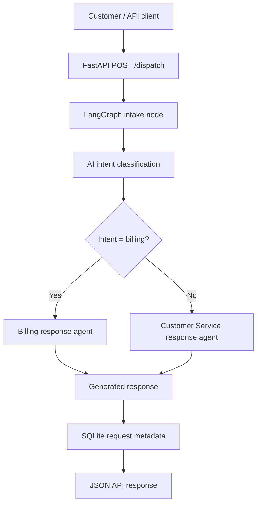

# Dispatcher Mini

**AI-powered customer request classification and response generation**

Dispatcher Mini is a small customer-service dispatcher built with **FastAPI**, **LangGraph**, **LangChain**, **OpenAI GPT-4.1 mini**, and **SQLite**. It accepts a customer message, classifies its intent, selects a department, generates a professional draft response, and stores basic request metadata.

Developed as a portfolio project for **3SAI Solutions Inc.**

## Live API

- **API documentation:** https://dispatcher.webwatchhq.com/docs
- **Service endpoint:** https://dispatcher.webwatchhq.com/
- **Dispatch endpoint:** `POST https://dispatcher.webwatchhq.com/dispatch`

The public deployment uses HTTPS via Nginx and Let's Encrypt. API availability may vary during maintenance.

> **Security note:** The currently shown API implementation does not include authentication, rate limiting, or request-size limits. Do not submit sensitive personal or financial information. Add these controls before production use with real customer data.

## Features

- Classifies incoming messages into `billing` or `general` using GPT-4.1 mini.
- Routes billing requests to a Billing response agent and other requests to a Customer Service response agent.
- Generates concise, department-aware AI responses.
- Persists the original message, intent, department, and creation timestamp in SQLite.
- Exposes a JSON REST API with interactive Swagger documentation.
- Supports Docker deployment and automated deployment to AWS EC2 after successful GitHub Actions tests.

**Not implemented:** sending SMS or email, initiating refunds, contacting employees, retrieving account information, or actually forwarding a request to a human. Twilio integration is a potential future enhancement.

## Architecture



The workflow is defined in `main.py`. The compiled graph executes `intake`, then `classify`, then conditionally `billing` or `customer_service`. A `routing_agent` function is defined in the source but **is not currently connected to the graph**; the conditional function `choose_agent()` performs routing.

### AI configuration

| Component | Model | Temperature | Behavior |
| --- | --- | --- | --- |
| Intent classifier | `gpt-4.1-mini` | `0` | Returns `billing` or `general` |
| Response generator | `gpt-4.1-mini` | `0.3` | Produces a polite, concise response for the selected department |

Billing covers payments, invoices, refunds, charges, and subscription payment issues. All other messages are classified as general requests. The classifier raises a `ValueError` if the model returns an unexpected category.

The response-generation prompt instructs the model not to invent business hours, policies, account information, completed actions, or response times. These instructions are safeguards, not guarantees.

## API reference

### `GET /`

Basic service response:

```json
{"message": "Dispatcher Mini is running!"}
```

### `POST /dispatch`

Request body:

```json
{
  "message": "I need help understanding a charge on my invoice."
}
```

Response shape (values below are illustrative, not a recorded API response):

```json
{
  "status": "processed",
  "message": "I need help understanding a charge on my invoice.",
  "intent": "billing",
  "department": "Billing",
  "response": "I can help explain the charge in general terms. A representative can review your specific invoice."
}
```

Test with cURL:

```bash
curl -X POST 'https://dispatcher.webwatchhq.com/dispatch' \
  -H 'Content-Type: application/json' \
  -d '{"message":"I have a question about my invoice."}'
```

**Note:** This endpoint invokes a paid external AI API and currently has no authentication or rate limiting. Restrict public access before inviting unrestricted traffic.

### `GET /docs`

FastAPI-generated interactive Swagger UI.

## Project structure

```text
dispatcher-mini/
├── api.py                  # FastAPI application and endpoints
├── main.py                 # LangGraph state, nodes, and routing
├── ai_classifier.py        # Intent classification with GPT-4.1 mini
├── ai_responder.py         # Department-specific response generation
├── database.py             # SQLite table creation and inserts
├── requirements.txt        # Python dependencies
├── Dockerfile              # Container image definition
└── .github/workflows/      # Tests and deployment automation
```

Other repository files are not listed here.

## Local development

### Prerequisites

- Python 3.11 (the Docker image uses Python 3.11)
- An OpenAI API key with access to `gpt-4.1-mini`

### Installation

```bash
git clone https://github.com/axel7991/dispatcher-mini.git
cd dispatcher-mini
python -m venv .venv
```

Activate the virtual environment:

**Linux / macOS**

```bash
source .venv/bin/activate
```

**Windows PowerShell**

```powershell
.\.venv\Scripts\Activate.ps1
```

Install dependencies:

```bash
pip install -r requirements.txt
```

Create a local `.env` file (do not commit it):

```dotenv
OPENAI_API_KEY=your_api_key_here
```

Run the API:

```bash
uvicorn api:app --host 127.0.0.1 --port 8000 --reload
```

Open http://127.0.0.1:8000/docs.

SQLite defaults to `dispatcher.db` in the working directory unless `DATABASE_PATH` is set. The application creates its `requests` table when `api.py` is imported.

## SQLite persistence

Table: `requests`

| Column | SQLite declaration | Purpose |
| --- | --- | --- |
| `id` | `INTEGER PRIMARY KEY AUTOINCREMENT` | Unique request identifier |
| `message` | `TEXT NOT NULL` | Customer message |
| `intent` | `TEXT` | `billing` or `general` |
| `department` | `TEXT` | Billing or Customer Service |
| `created_at` | `TIMESTAMP DEFAULT CURRENT_TIMESTAMP` | Creation timestamp |

The generated response is **not** saved to the database. Database writes use parameterized queries.

## Docker

Build locally:

```bash
docker build -t dispatcher-mini:latest .
```

Run locally with a named volume:

```bash
docker run -d \
  --name dispatcher-mini \
  --env-file .env \
  -e DATABASE_PATH=/app/data/dispatcher.db \
  -p 127.0.0.1:8002:8000 \
  -v dispatcher-mini-data:/app/data \
  dispatcher-mini:latest
```

The named volume keeps the SQLite database across container replacement. The port binding restricts direct access to the host's loopback interface.

## AWS EC2 deployment

The live project is deployed to an **Amazon Linux 2023 EC2 instance** using Docker and Nginx.

```text
Internet client
    |
    v
https://dispatcher.webwatchhq.com
    |
    v
Nginx :443 (Let's Encrypt TLS)
    |
    v
127.0.0.1:8002
    |
    v
Docker container :8000 (FastAPI)
    |
    v
Docker volume dispatcher-mini-data (SQLite)
```

The `dispatcher` DNS A record points to the EC2 public address. Nginx forwards HTTPS requests to the locally bound container. Certbot has configured scheduled certificate renewal.

### CI/CD

The repository contains a `Python Tests` GitHub Actions workflow and a `Deploy Dispatcher Mini to EC2` workflow. The deployment workflow is triggered after a successful `Python Tests` run on `main` and:

1. Connects to EC2 over SSH using GitHub Actions secrets.
2. Checks out the tested commit.
3. Builds the Docker image on the instance.
4. Replaces the Dispatcher Mini container.
5. Mounts the persistent SQLite volume and binds host port `127.0.0.1:8002`.

Deployment secrets used by the workflow:

| Secret | Purpose |
| --- | --- |
| `EC2_HOST` | Server hostname or IP |
| `EC2_USER` | SSH username |
| `EC2_SSH_KEY` | SSH private key for deployment |

The OpenAI key is stored in a server-side `.env` file and is **not** committed to GitHub. Do not paste secrets into issues, logs, screenshots, or documentation.

### Basic operational checks

```bash
docker ps --filter name=dispatcher-mini
curl -I http://127.0.0.1:8002/docs
sudo nginx -t
curl -I https://dispatcher.webwatchhq.com/docs
```

A `200 OK` response from `/docs` confirms the documentation endpoint is responding, but does not by itself verify an end-to-end AI dispatch.

## Testing and limitations

GitHub Actions has successfully run the existing test workflow and deployed the application. This README does not claim specific test coverage or end-to-end dispatch success without a corresponding verified test result.

Current limitations include:

- No API authentication or rate limiting.
- No explicit exception handling around AI service failures or unexpected classifications.
- No automatic human handoff or outbound messaging.
- Only two intent categories and two response departments.
- No saved AI response, customer identity, or request status tracking.
- No database migration mechanism documented.
- Dependencies are unpinned, which may affect reproducibility.

## Roadmap

- [ ] Add API authentication, rate limiting, and request validation limits.
- [ ] Add robust AI failure handling and observability.
- [ ] Add unit and end-to-end tests with mocked AI calls.
- [ ] Add configurable departments and more granular intent classification.
- [ ] Add optional Twilio SMS integration, with consent and compliance controls.
- [ ] Add request tracking, human review, and audit logging.
- [ ] Pin and audit dependencies; improve deployment health checks and rollback.

## Responsible use

Customer messages may be sent to an external AI provider for processing. Review privacy requirements, obtain any necessary consent, and define retention and access policies before processing real customer information. Generated text should be reviewed when the context is sensitive or consequential.

## Maintainer

**3SAI Solutions Inc.** — Portfolio project

Repository: https://github.com/axel7991/dispatcher-mini
